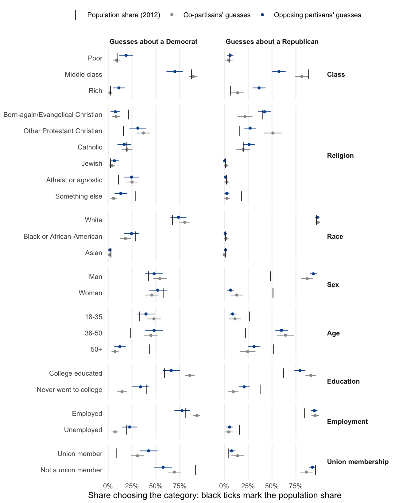

# Picturing the Other Party: What Partisans Guess about a Randomly Drawn Democrat and Republican

Douglas J. Ahler and Gaurav Sood

[Paper](ms/main.pdf)

## Question

When partisans picture a member of the other party, do they picture a typical member or a distinctive one? A November 2013 Mechanical Turk survey told 343 Democrats, Republicans and independents that they had been paired with one Democrat and one Republican from a representative survey. It then asked for a best guess about each person's class, religion, race, sex, age, education, employment and union membership.

A best guess about one random person has a right answer: the category most common in that party. Unlike asking what percentage of a party belongs to a group, it needs no arithmetic and no knowledge of how large the group is.

## Design

The guesses are scored against weighted 2012 population shares from the Cooperative Congressional Election Study, with class taken from the General Social Survey. The GSS serves as a second, independently coded benchmark for every attribute.

Each category's *likelihood ratio* is its share in the target's party divided by its share in the other party. For example, being Black is 21 times as common among Democrats as among Republicans. The comparisons are:

- how often guesses name the most common category;
- how often opposing partisans and co-partisans choose the most distinctive category where it is not the most common one;
- a conditional logit model of how guesses respond to population shares and likelihood ratios;
- the randomized order in which the two parties were asked about;
- the association between stereotyped guesses and how extreme respondents place the other party.

## Findings



- **Opposing partisans lean toward what is distinctive.** In the cells where the most distinctive category is not the most common one, they choose it 9.2 percentage points more often than co-partisans do (95% CI 4.6 to 13.8). The gap is 11.0 points after adjusting for respondent party, and 5.0 points (1.1 to 8.8) with GSS benchmarks throughout. For example, 36% of Democrats guessed the Republican was rich, against 14% of Republicans and a GSS upper-class share of 6.5%.
- **Both sides share some distortions.** They picture the Republican as a man and the Democrat as young and nonreligious.
- **Race is the exception.** Both sides under-guess that the Democrat is Black: 18% and 25%, against 29% in the CCES. The conditional logit's weight on distinctiveness depends heavily on this one attribute.
- **Accuracy is low.** Guesses are about as accurate as guessing in proportion to the true shares, and well below always naming the most common category.
- **Order made no difference** to the number of distinctive guesses. The one item that differed by order is the union question for the Democrat, which in one block displayed the wrong respondent number.
- **Stereotypes and perceived extremity are weakly linked.** Each additional distinctive guess about the other party goes with placing it 0.05 points further from the center of a 7-point scale. The extremity of the leaders respondents recall does not predict it.

The manuscript generates all of these numbers from `tabs/macros.tex`.

## Reproduce

With R 4.6, XeLaTeX and latexmk:

```sh
make restore   # install the package versions in renv.lock
make check     # analysis, tables, figures, manuscript, lint, tests
```

`make ci-docker` runs the same checks in the `rocker/verse:4.6.0` image. The build makes no network calls. `make benchmarks` re-downloads the CCES and GSS files and rewrites the frozen extracts; the tests check those extracts against the hashes in `data/benchmark_sources.csv` and against CCES codebook counts.

## Files

| Path | Contents |
|---|---|
| `data/survey_2013.csv` | The 2013 survey export with IP addresses, MTurk worker IDs and assignment IDs removed; `worker_index` numbers workers so repeat takers remain identifiable |
| `data/cces_2012.csv`, `data/gss_2012.csv` | Columns used from the 2012 CCES Common Content (doi:10.7910/DVN/HQEVPK) and the 2012 GSS |
| `data/recall_name_crosswalk.csv`, `data/politician_scores.csv` | Name coding and CF-scores for recalled leaders, copied from `extreme_recall` (commit 3f5a1aa) |
| `data/respondents.csv`, `data/guesses.csv`, `data/benchmarks.csv`, `data/scored_guesses.csv` | Derived by `scripts/01_prepare.R` and `scripts/02_estimate.R` |
| `R/` | Data preparation, benchmark coding, estimators, exhibit helpers |
| `scripts/` | `00_fetch_benchmarks.R` (manual), then `01_prepare.R`, `02_estimate.R`, `03_exhibits.R` |
| `tabs/`, `figs/` | Generated tables, figures and manuscript macros |
| `docs/instrument.pdf` | The fielded Qualtrics instrument |

The 2015 scripts and Stata files remain in the Git history before this revision.

<!-- adjacent:start -->

<!-- adjacent:end -->
